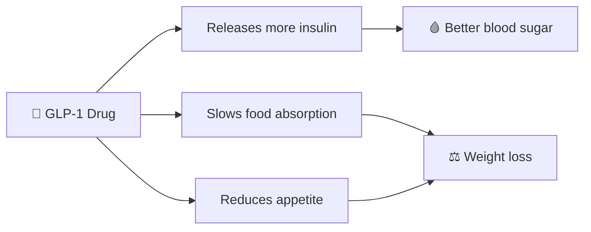

# 💊 India's Weight Loss Drug Revolution
### Slimming Down, Scaling Up: India's Multi-Billion Dollar Weight Loss Opportunity

**By Rahul Dhas**

### [📖 Read the Full Report →](https://github.com/rahuldhas-hub/India-s-Weight-Loss-Drug-Revolution/blob/9f12915cc231feddd806d7e2a0ef70f399dcad55/Weight%20loss%20industry%20detailed%20report.pdf)

---

## 🎯 What This Is About
India is the "Diabetes Capital of the World," and obesity is becoming a national health crisis. **GLP-1 drugs**, originally made for diabetes, are now reshaping how India fights obesity, and creating a huge opportunity for Indian pharma.

## 📊 India by the Numbers
| | |
|---|---|
| 🩸 **77 million+** | Indians living with diabetes (17% of global cases) |
| ⚖️ **100 million+** | Projected number of obese Indians |
| 💊 **15–23%** | Average weight loss with Semaglutide and Tirzepatide |
| 📈 **₹3,000 Cr → ₹25,000 Cr** | India's anti-obesity drug market, now to 2030 |
| 💰 **~₹500 / month** | Projected cost of Indian-made semaglutide (vs. up to $16,000/yr in the US) |

## 🧬 How GLP-1 Drugs Work

## 🚧 The Big Challenge: Affordability
Branded drugs like **Mounjaro (₹14,000–₹17,500/month)** and **Wegovy (₹17,345–₹26,015/month)** are out of reach for most Indians. Cheaper generics could change that.

## 🏭 Who's Racing to Make Them?
**Biocon • Dr. Reddy's • Sun Pharma • Cipla • Lupin • Zydus • Glenmark • Natco • Aurobindo • Granules India**

Global giants **Novo Nordisk** (Wegovy, Ozempic) and **Eli Lilly** (Mounjaro) are competing for the same market.

## 💡 Key Trends to Watch
- 🧪 Generic and biosimilar launches after patent expiry
- ⚗️ Peptide API and CDMO specialists
- 💊 Novel and oral GLP-1 drugs
- 🖊️ Pen injectors and autoinjectors
- 📱 Digital obesity and diabetes management platforms

## 🌍 Beyond Medicine
GLP-1s may change **eating habits** (smaller portions, fewer snacks and soft drinks), pressure **insurance coverage**, and shape **regulatory policy** in India.

---

## 📖 Want the Full Story?
This is just a summary. The complete analysis, with the company-by-company investment table, is in the full article:

### 👉 [Read it on LinkedIn](https://www.linkedin.com/pulse/indias-weight-loss-drug-revolution-how-glp-1-drugs-health-rahul-dhas-h54tf/)

*Disclaimer: For informational purposes only. Not investment advice.*

⭐ Found this useful? Star the repo and connect with me on LinkedIn!

